<div align="center">

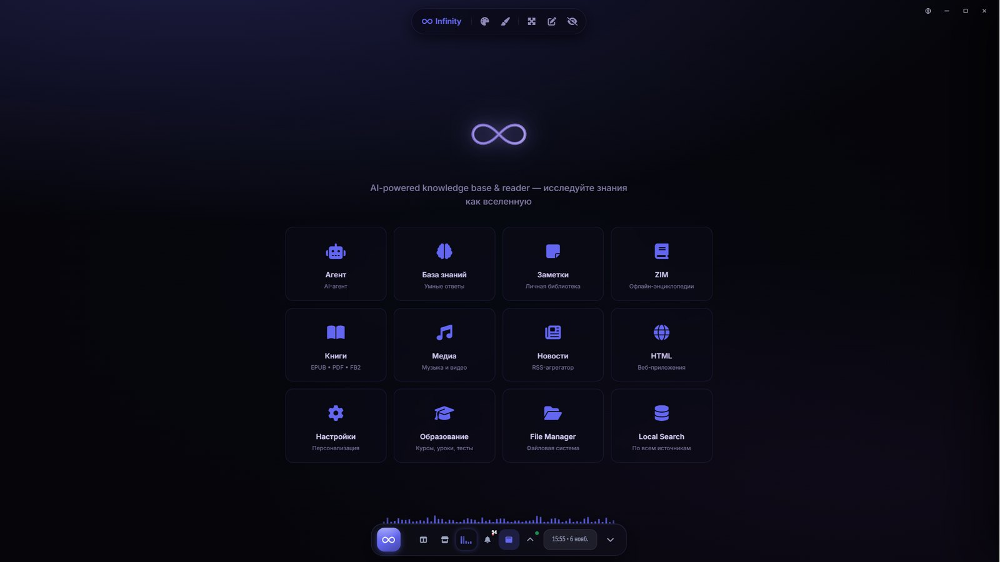

# ∞ Infinity Search

**A personal workspace for search, knowledge, books, media, notes and communication — on your own computer, without the cloud.**


[English](README.en.md) · [Русский](README.md) · [System guide](docs/en/SYSTEM.md) · [Extensions](docs/en/EXTENSIONS.md) · [Install](docs/en/INSTALL.md) · [User guide](docs/en/USER-GUIDE.md) · [FAQ](docs/en/FAQ.md) · [Repository](docs/REPOSITORY.md)

</div>

---

## About

Infinity Search is not a single-purpose program. It is an environment where everything
you need lives in one window. It runs on your computer, opens like a regular desktop
app, and keeps working without the internet: files, notes, books, music, history and
settings stay on your disk.

One entry point gives you search across everything you have, a book library and
reader, a media library, a news feed, connected notes, learning courses, a file
manager, a built-in browser, an app catalog and an assistant that can work with this
space.

The project grew out of a personal need: keep tens of thousands of documents, books
and notes in order without sending them to third-party services.

---

## Features

### 🔎 Search everything

A single search box looks through files, notes, books, articles, browser history and
offline libraries. Results can be filtered by source, date and type. Frequent queries
are remembered, and search still works when there is no internet.

- instant suggestions and typo correction;
- search inside documents, not only in file names;
- separate collections for books, news, notes and HTML apps.

### 📝 Notes and knowledge base

Notes support plain text, Markdown, formulas, tables, charts, attachments and tags.
A graph of connections shows which topics intersect and what is still unfinished.

- six editor modes — from plain text to tables and code;
- connection graph and semantic groups;
- quick notes via `Shift+Space` from anywhere;
- versions, trash and recovery;
- export to Markdown, HTML and other formats.

### 📚 Books and reading

The library accepts EPUB, FB2, PDF, TXT and other formats. Covers, authors, genres and
reading progress are collected automatically. Your position in a book is saved, and
the reader adapts to the window width and theme.

- shelves, categories, favorites and recommendations;
- table of contents, bookmarks, quotes and full-book search;
- text-to-speech and translation;
- format conversion and metadata editing;
- offline ZIM encyclopedias right in the library.

### 🎵 Music, video and photos

The media library indexes your folders and builds a collection with covers, artists,
albums and playlists. The built-in player supports queues, a sleep timer, an equalizer
and position memory.

- 2,000+ tracks without lag and with fast search;
- playlists, favorites, recent items and recommendations;
- photo albums with previews and sorting;
- video playback and subtitles;
- downloads and seeding through the built-in torrent client.

### 📰 News and article reading

The RSS aggregator collects materials from your sources and organizes them by topic,
region and date. An article can be opened in reading mode, translated, saved to notes
or bookmarked.

- your own sources and categories;
- filters by region, period and type;
- ad-free reading mode;
- translation and text-to-speech;
- smart digest based on your interests.

### 🗂️ Files and disk order

The file manager shows a tree, grid and list, and can search, rename, copy, encrypt
and share files. The trash lets you restore deleted items.

- multiple folder access profiles;
- sharing and links;
- archive compression and extraction;
- previews for documents, images and media;
- disk indexing and fast search.

### 🌐 Browser and web apps

The built-in browser opens pages and local HTML apps in separate windows. A start
page, translation, extensions and session persistence are all inside the app.

- tabs, history, bookmarks and downloads;
- page translation and reading mode;
- custom interface extensions;
- local HTML apps launched like regular programs.

### 🎓 Learning

Courses, lessons and flashcards help you learn at your own pace. Progress is saved,
and materials can be collected from notes, books and articles.

- courses and lessons with progress;
- spaced-repetition flashcards;
- tests and knowledge checks;
- achievements and statistics.

### 🧩 Apps and extensions

The built-in app catalog is dozens of tools in one window: graphics, documents,
spreadsheets, audio, 3D and much more. Extensions add new capabilities without
rebuilding the app.

- app installation and updates;
- extension marketplace and custom repositories;
- no-code extension builder;
- access permissions and rollback.

For a deep dive, see [`docs/en/EXTENSIONS.md`](docs/en/EXTENSIONS.md).

### 🗣️ Communication and communities

The built-in social network includes profiles, a feed, friends, messages, groups,
channels and articles. You can keep it local or enable federation.

- feed and profiles;
- direct messages and group chats;
- groups, channels, articles and albums;
- ActivityPub federation;
- bots and webhooks for external messengers.

### 🤝 Assistant and automation

The built-in assistant works with your documents: answers questions, searches by
meaning, creates summaries, helps with text and runs scheduled tasks. You can use
local models or connect an external provider.

- answers based on your documents;
- help with text, translation and code;
- scheduled tasks;
- voice input and speech synthesis;
- a sandbox for safe command execution.

### ⚙️ Make it yours

Profiles, themes, fonts, accent colors, workspaces and hotkeys. Each profile keeps its
own settings, data and access rules.

- light and dark themes, accent colors;
- multiple workspaces and a window manager;
- profiles with passwords and permissions;
- backups and recovery;
- admin panel and monitoring.

---

## Screenshots

| Main screen | Media library |
|:--:|:--:|
| 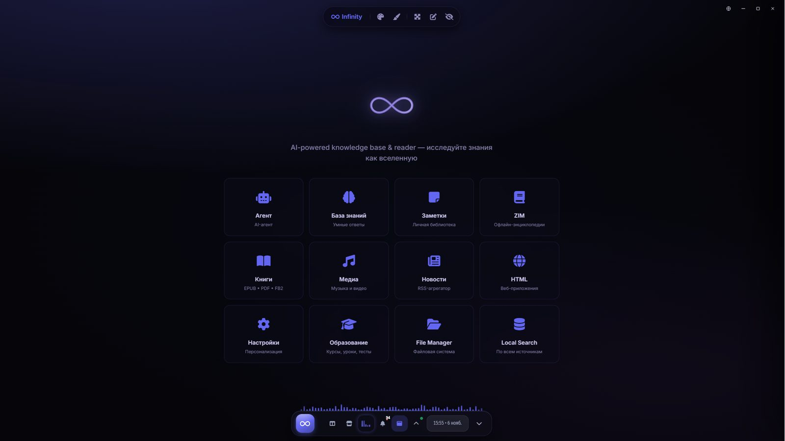 | 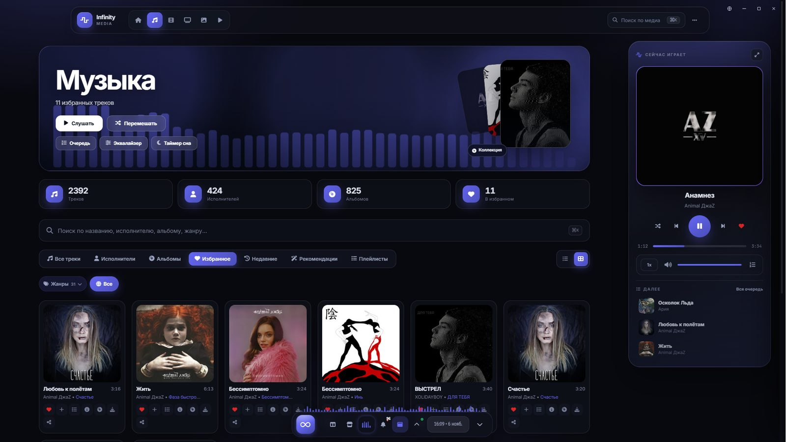 |
| All sections in one grid | Music, albums, playlists and player |

| Book library | Reader |
|:--:|:--:|
| 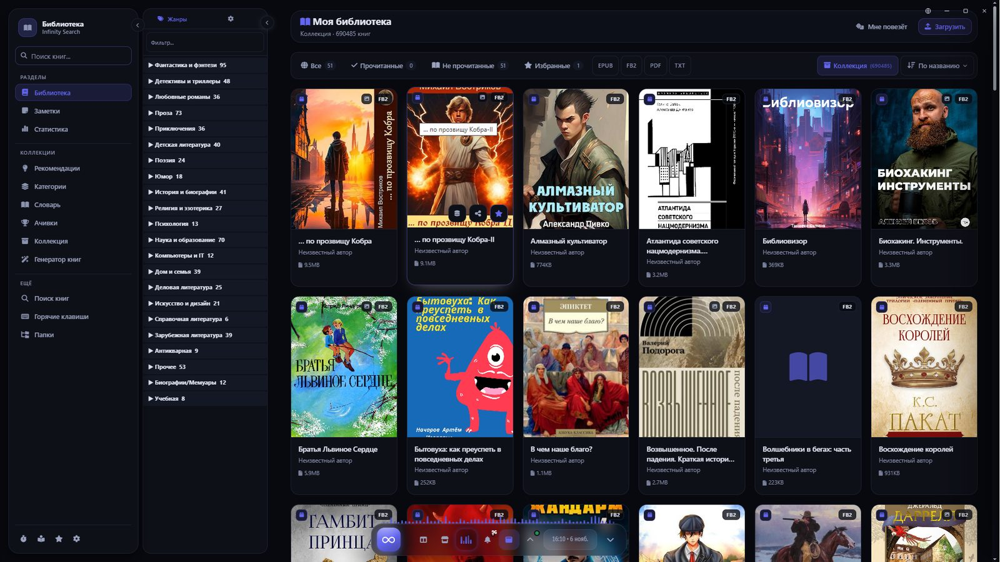 | 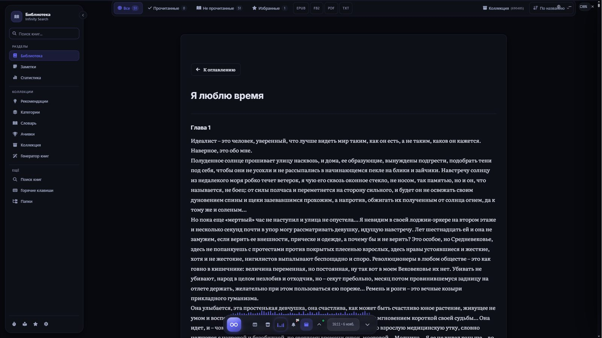 |
| Covers, genres and shelves | Table of contents, bookmarks and position memory |

| App catalog | News |
|:--:|:--:|
| 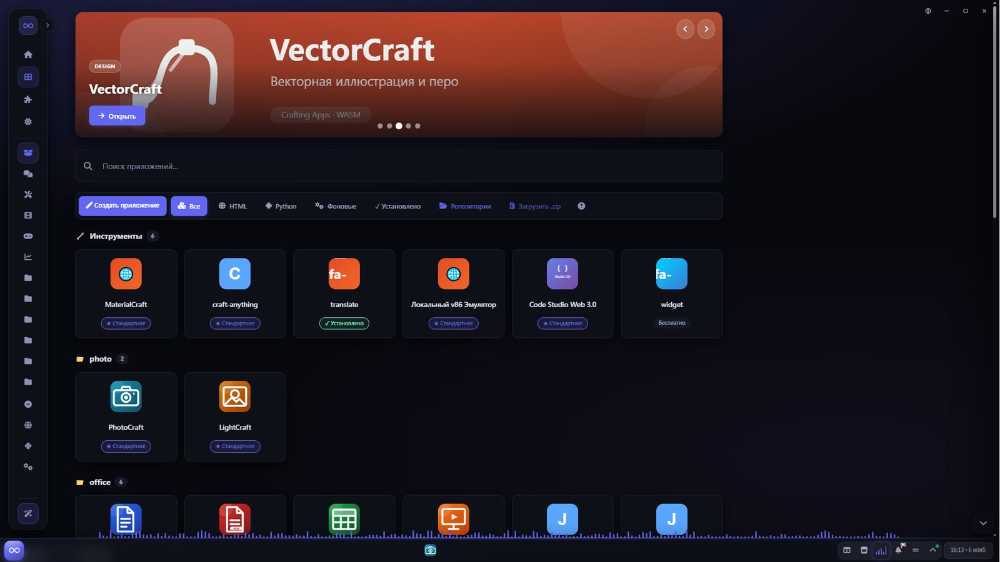 | 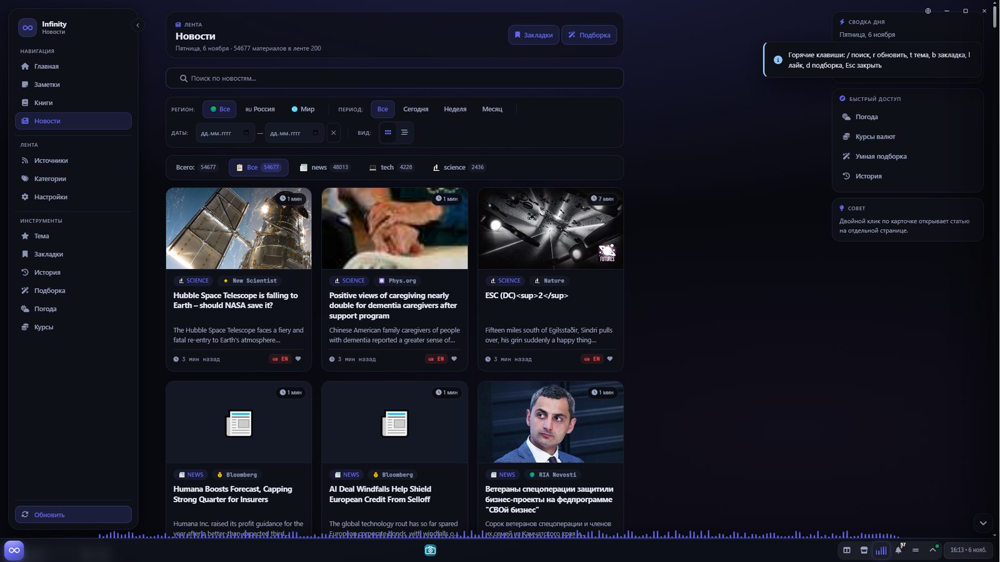 |
| Apps and the extension store | Feed with filters and digests |

| Notes | Focus mode |
|:--:|:--:|
| 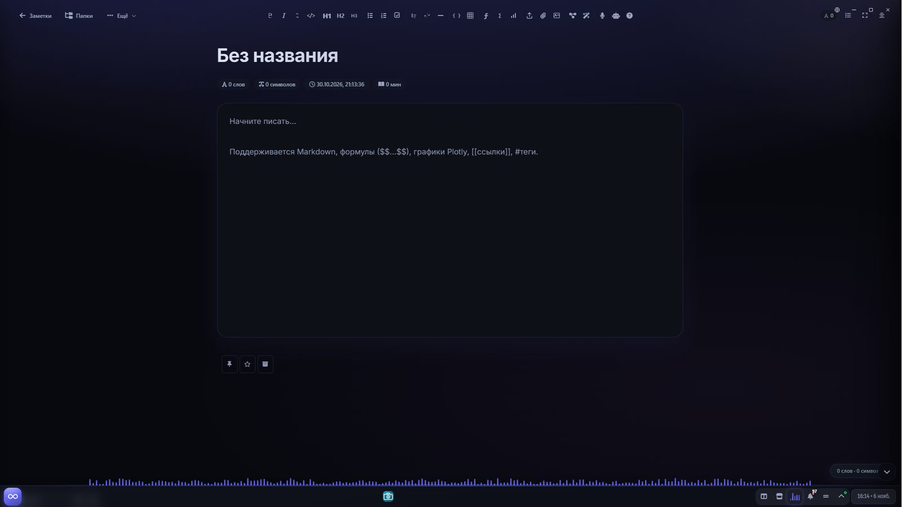 | 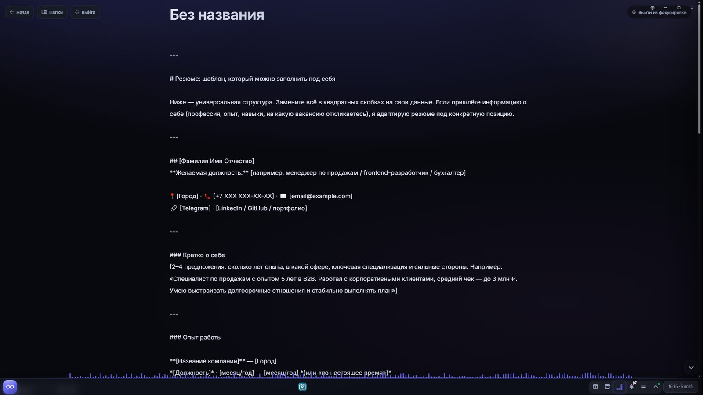 |
| Editor with formulas and tables | Just the text, nothing else |

| Offline encyclopedias | ZIM reader |
|:--:|:--:|
| 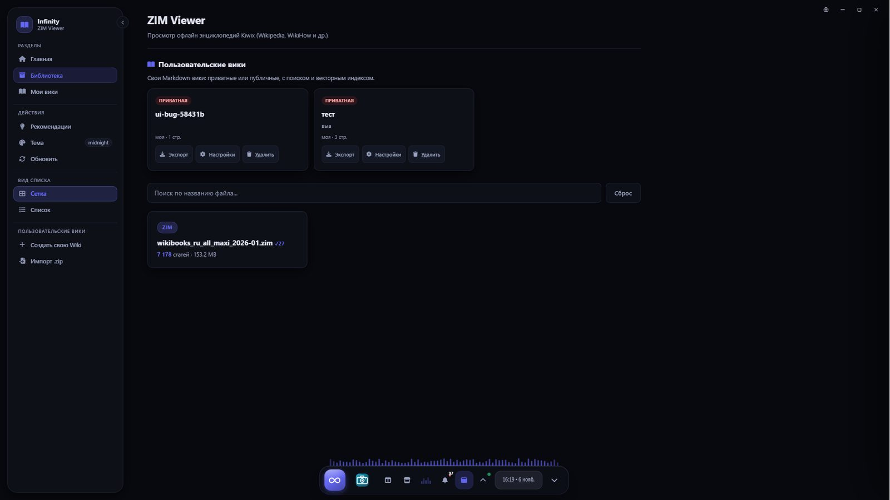 | 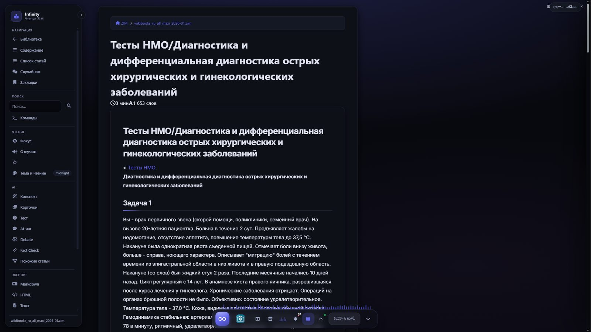 |
| ZIM archive library | Articles with contents and search |

| Learning | Settings |
|:--:|:--:|
| 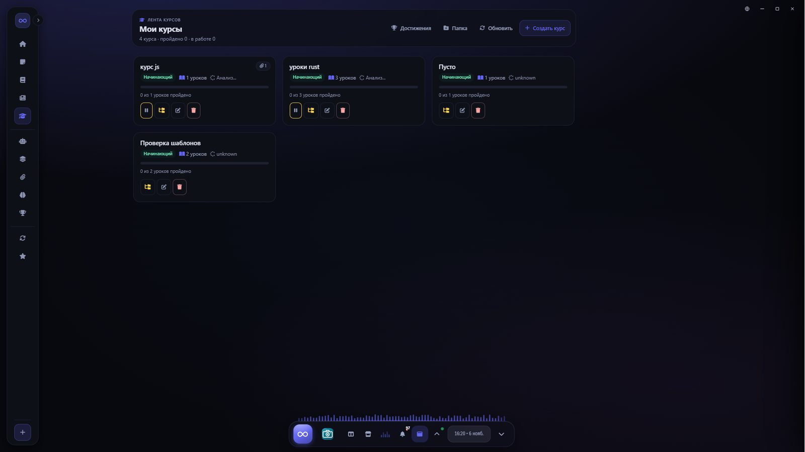 | 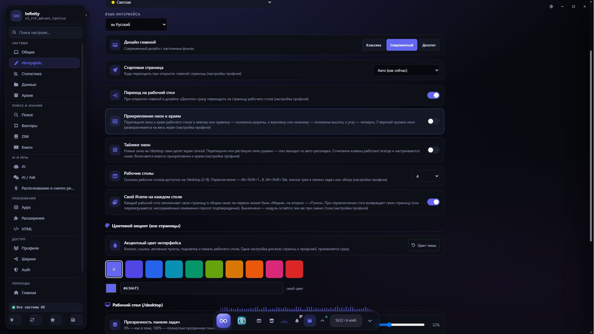 |
| Courses, lessons and progress | Interface, themes and workspaces |

| Built-in apps |  |
|:--:|:--:|
| 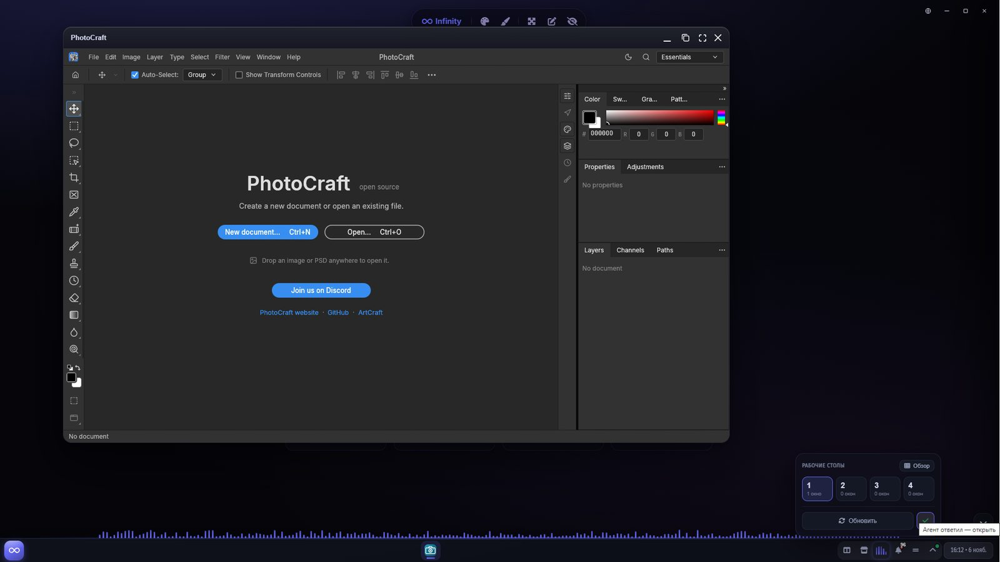 |  |
| Graphics, documents, spreadsheets and 3D in one window |  |

---

## Quick start

### Option 1 — ready-to-run portable build

Download the archive from **Releases**, extract it into any folder and run:

```bat
start.bat
```

Nothing needs to be installed: Python, dependencies and the engine are already inside.
On first launch the app creates `data`, `logs`, `models` and a default profile.

### Option 2 — from source

You need **Python 3.12+** for Windows and, optionally, Node.js for the Electron window.

```bat
git clone https://github.com/noevekshen545/infinityHub.git
cd infinityHub
setup.bat
```

`setup.bat` is an interactive wizard: it checks Python, creates the environment,
installs dependencies and asks what else to install — Electron, ffmpeg, Chromium,
Whisper, Silero, Piper, Qdrant embeddings, Hermes, llama.cpp, a gguf model, VLC,
Calibre, ComfyUI and the app catalog. You can pick only what you need.

Manual option:

```bash
./scripts/bootstrap.sh --all
```

Or in PowerShell:

```powershell
.\scripts\bootstrap.ps1 -All
```

Then:

```bat
run-dev.bat
```

Open <http://127.0.0.1:8281>.

`bootstrap` installs Python and Electron dependencies, creates folders, downloads
Chromium for the built-in browser and ffmpeg. Heavy engines and models are connected
separately — see [`docs/en/EXTERNAL.md`](docs/en/EXTERNAL.md).

> If you only need the web interface without Electron, `run-dev.bat` is enough.

---

## Size

| Variant | Contents | Size |
|---|---|---:|
| **Source without the agent** | code, templates, styles, screenshots and docs | **~100 MB** |
| **Repository as is** | plus Hermes Agent, 3D avatars and Avi | **~350 MB** |
| **Repository with history** | plus the `.git` folder | **~500 MB** |
| **Portable light** | exe, embedded Python, Hermes, engine, Electron — no models | **~3.9 GB** |
| **Portable full** | plus ffmpeg, VLC, Playwright, Calibre and the agent profile | **~7 GB** |
| **With models and catalogs** | plus models, ComfyUI and the app catalog | **~25 GB** |
| **Working machine** | plus user data, cache and backups | **~35 GB** |

Why the repository is about 350 MB: roughly 100 MB is source code and offline frontend
libraries (Monaco, Univer, Luckysheet, Plotly, Three.js, fonts and 89 HTML pages),
162 MB is the Hermes Agent and 111 MB is 3D avatars. Python dependencies and
`node_modules` are not stored in Git — `bootstrap` downloads them. If you do not need
the agent and avatars in the repository, they can be moved to a release asset, bringing
the repo back to ~100 MB.

---

## Documentation

- [`docs/en/SYSTEM.md`](docs/en/SYSTEM.md) — **full system guide**: every module, feature and capability.
- [`docs/en/EXTENSIONS.md`](docs/en/EXTENSIONS.md) — extension system: manifest, hooks, permissions, sandbox, builder.
- [`docs/en/INSTALL.md`](docs/en/INSTALL.md) — installation, updates and distribution variants.
- [`docs/en/USER-GUIDE.md`](docs/en/USER-GUIDE.md) — first steps and each section.
- [`docs/en/MODULES.md`](docs/en/MODULES.md) — module catalog and capabilities.
- [`docs/en/EXTERNAL.md`](docs/en/EXTERNAL.md) — engines, models and external components.
- [`docs/en/FAQ.md`](docs/en/FAQ.md) — common questions and troubleshooting.
- [`docs/en/DEVELOPMENT.md`](docs/en/DEVELOPMENT.md) — project structure and building.
- [`docs/REPOSITORY.md`](docs/REPOSITORY.md) — description, topics and social preview.
- [`CONTRIBUTING.md`](CONTRIBUTING.md) — how to contribute.
- [`SECURITY.md`](SECURITY.md) — security policy.
- [`CHANGELOG.md`](CHANGELOG.md) — release history.

Russian documentation: [`docs/README.md`](docs/README.md).

---

## Topics and tags

`#local-first` `#offline` `#windows` `#fastapi` `#electron` `#llama-cpp`
`#personal-search` `#knowledge-base` `#notes` `#books` `#media` `#self-hosted`
`#privacy` `#mit`

Suggested GitHub topics: `local-first`, `offline`, `windows`, `fastapi`, `electron`,
`llama-cpp`, `personal-search`, `knowledge-base`, `notes`, `books`, `media`,
`self-hosted`, `privacy`, `mit`.

How to set the repository card, topics and social preview: [`docs/REPOSITORY.md`](docs/REPOSITORY.md).

---

## Technology

The app is built with Python and Electron. The interface is plain HTML, CSS and
JavaScript that runs in the app window and in a browser. Local models are connected
through a compatible interface, so you can use a ready engine or an external service.

The project does not require the cloud, subscriptions or a permanent internet
connection. Everything needed to run lives next to the application.

---

## License

[MIT](LICENSE) © 2026 Infinity Search contributors.

Third-party components (Hermes Agent, Calibre, ComfyUI, ffmpeg, VLC and others) are
distributed under their own licenses. See [`docs/en/EXTERNAL.md`](docs/en/EXTERNAL.md).

---

<div align="center">

**Infinity Search** · [github.com/noevekshen545](https://github.com/noevekshen545)

<sub>Built for people who prefer to keep their knowledge to themselves.</sub>

</div>
