<div align="center">

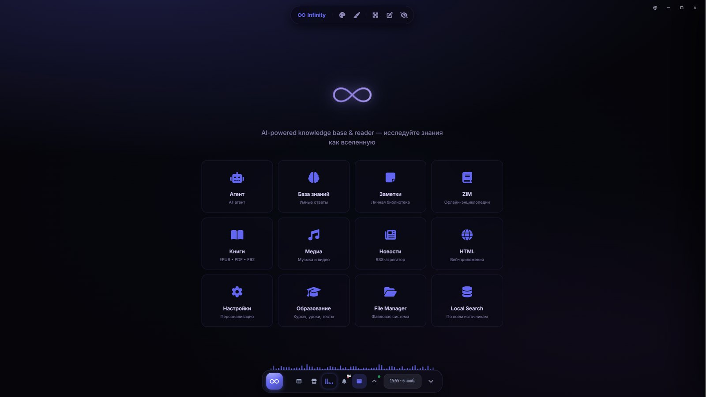

# ∞ Infinity Search

**Личное рабочее пространство: поиск, знания, книги, медиа, заметки и общение — на вашем компьютере, без облака.**


[Скачать](#быстрый-старт) · [Возможности](#возможности) · [Скриншоты](#скриншоты) · [Документация](#документация)

</div>

---

## О проекте

Infinity Search — это не отдельная программа для одной задачи, а среда, в которой всё
нужное находится в одном окне. Она запускается на вашем компьютере, открывается как
обычное приложение и продолжает работать без интернета: файлы, заметки, книги, музыка,
история и настройки остаются на диске.

Один вход — и доступны поиск по всему, что у вас есть, читалка книг, медиатека,
новостная лента, заметки со связями, учебные курсы, файловый менеджер, встроенный
браузер, каталог приложений и помощник, который умеет работать с этим пространством.

Проект вырос из личной необходимости: держать десятки тысяч документов, книг и записей
в порядке, не отправляя их в чужие сервисы.

---

## Возможности

### 🔎 Поиск по всему

Единая строка ищет по файлам, заметкам, книгам, статьям, истории браузера и офлайн-
библиотекам. Результаты можно фильтровать по источнику, дате и типу, а частые запросы
запоминаются. Поиск работает даже тогда, когда интернета нет.

- мгновенные подсказки и исправление опечаток;
- поиск по содержимому документов, а не только по названиям;
- отдельные подборки для книг, новостей, заметок и HTML-приложений.

### 📝 Заметки и база знаний

Заметки поддерживают обычный текст, Markdown, формулы, таблицы, графики, вложения и
теги. Из заметок строится граф связей: видно, какие темы пересекаются и что осталось
без продолжения.

- шесть режимов редактора — от простого текста до таблиц и кода;
- граф связей и смысловые группы;
- быстрые заметки по `Shift+Space` из любого места;
- версии, корзина и восстановление;
- экспорт в Markdown, HTML и другие форматы.

### 📚 Книги и чтение

Библиотека принимает EPUB, FB2, PDF, TXT и другие форматы. Обложки, авторы, жанры и
прогресс чтения собираются автоматически. Позиция в книге сохраняется, а читалка
подстраивается под ширину окна и тему.

- полки, категории, избранное и рекомендации;
- оглавление, закладки, цитаты и поиск по всей книге;
- озвучивание текста и перевод;
- конвертация форматов и работа с метаданными;
- офлайн-энциклопедии ZIM прямо в библиотеке.

### 🎵 Музыка, видео и фото

Медиатека индексирует ваши папки и собирает коллекцию с обложками, исполнителями,
альбомами и плейлистами. Встроенный плеер умеет очередь, таймер сна, эквалайзер и
запоминание позиции.

- 2 000+ треков без лагов и с быстрым поиском;
- плейлисты, избранное, недавнее и рекомендации;
- фотоальбомы с превью и сортировкой;
- просмотр видео и субтитров;
- скачивание и раздача через встроенный торрент-клиент.

### 📰 Новости и чтение статей

RSS-агрегатор собирает материалы из выбранных источников и раскладывает их по темам,
регионам и датам. Статью можно открыть в режиме чтения, перевести, сохранить в заметки
или добавить в закладки.

- свои источники и категории;
- фильтры по региону, периоду и типу;
- режим чтения без рекламы;
- перевод и озвучивание;
- умная подборка по интересам.

### 🗂️ Файлы и порядок на диске

Файловый менеджер показывает дерево, сетку и список, умеет искать, переименовывать,
копировать, шифровать и отправлять файлы. Корзина позволяет восстановить удалённое.

- несколько профилей доступа к папкам;
- общий доступ и ссылки;
- сжатие и распаковка архивов;
- предпросмотр документов, картинок и медиа;
- индексация дисков и быстрый поиск.

### 🌐 Браузер и веб-приложения

Встроенный браузер открывает страницы и локальные HTML-приложения в отдельных окнах.
Стартовая страница, перевод, расширения и сохранение сессий — всё внутри приложения.

- вкладки, история, закладки и загрузки;
- перевод страниц и режим чтения;
- собственные расширения интерфейса;
- запуск локальных HTML-приложений как обычных программ.

### 🎓 Обучение

Курсы, уроки и карточки помогают учиться в своём темпе. Прогресс сохраняется, а
материалы можно собирать из заметок, книг и статей.

- курсы и уроки с прогрессом;
- карточки для повторения;
- тесты и проверка знаний;
- достижения и статистика.

### 🧩 Приложения и расширения

Внутренний каталог приложений — это десятки инструментов в одном окне: графика,
документы, таблицы, звук, 3D и многое другое. Расширения добавляют новые возможности
без пересборки приложения.

- установка и обновление приложений;
- магазин расширений и свои репозитории;
- конструктор расширений без кода;
- права доступа и откат изменений.

### 🗣️ Общение и сообщества

Внутренняя социальная сеть: профили, лента, друзья, сообщения, группы, каналы и
статьи. Общение можно вести локально или подключить федерацию.

- лента и профили;
- личные сообщения и групповые чаты;
- группы, каналы, статьи и альбомы;
- федерация ActivityPub;
- боты и вебхуки для внешних мессенджеров.

### 🤝 Помощник и автоматизация

Встроенный помощник работает с вашими документами: отвечает на вопросы, ищет по
смыслу, делает выжимки, помогает с текстом и запускает задачи по расписанию.
Можно использовать локальные модели или подключить внешний провайдер.

- ответы по вашим документам;
- помощь с текстом, переводом и кодом;
- задачи по расписанию;
- голосовой ввод и озвучивание;
- песочница для безопасного выполнения команд.

### ⚙️ Настройка под себя

Профили, темы, шрифты, акцентные цвета, рабочие столы и горячие клавиши. Каждый профиль
хранит свои настройки, данные и доступы.

- светлая и тёмная темы, акцентные цвета;
- несколько рабочих столов и оконный менеджер;
- профили с паролями и правами;
- резервные копии и восстановление;
- админ-панель и мониторинг.

---

## Скриншоты

| Главный экран | Медиатека |
|:--:|:--:|
| 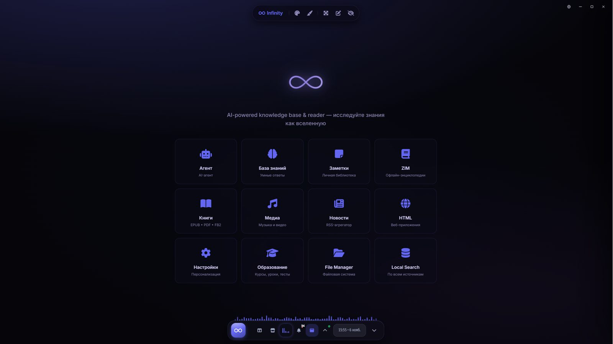 | 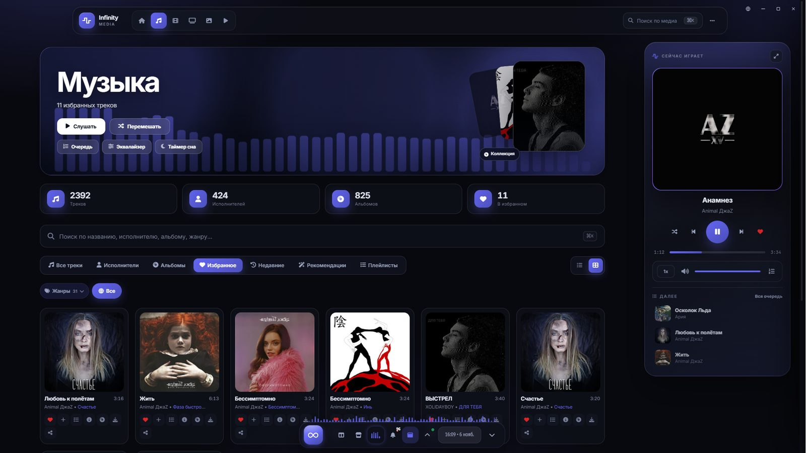 |
| Все разделы в одной сетке | Музыка, альбомы, плейлисты и плеер |

| Библиотека книг | Читалка |
|:--:|:--:|
| 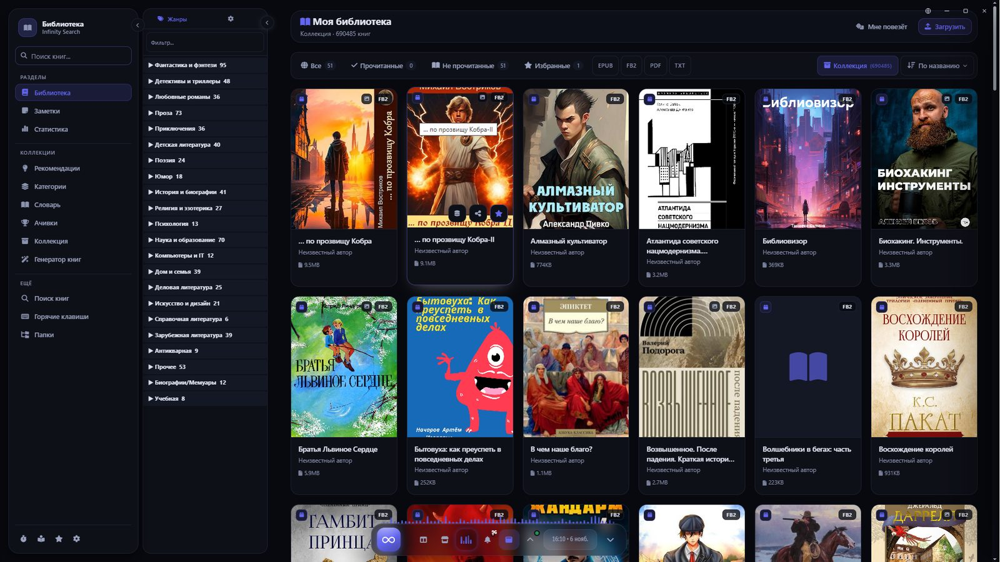 | 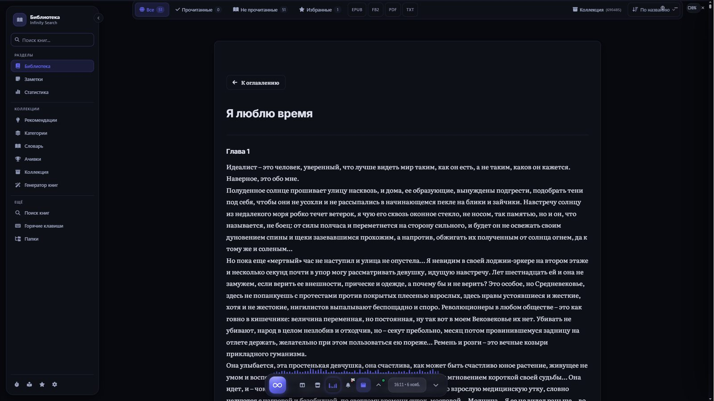 |
| Обложки, жанры и полки | Оглавление, закладки и сохранение позиции |

| Каталог приложений | Новости |
|:--:|:--:|
| 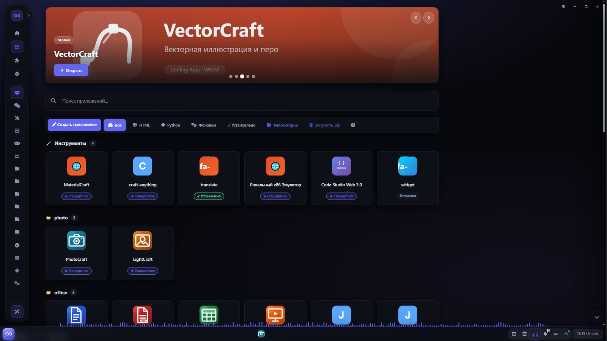 | 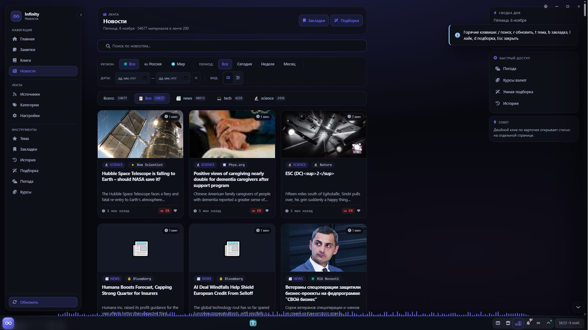 |
| Приложения и магазин расширений | Лента с фильтрами и подборками |

| Заметки | Режим фокуса |
|:--:|:--:|
| 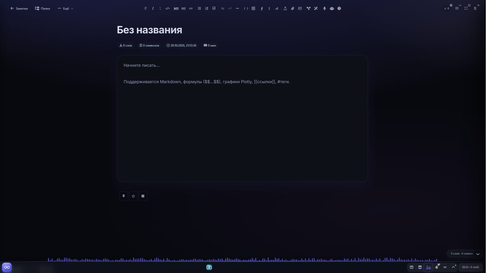 | 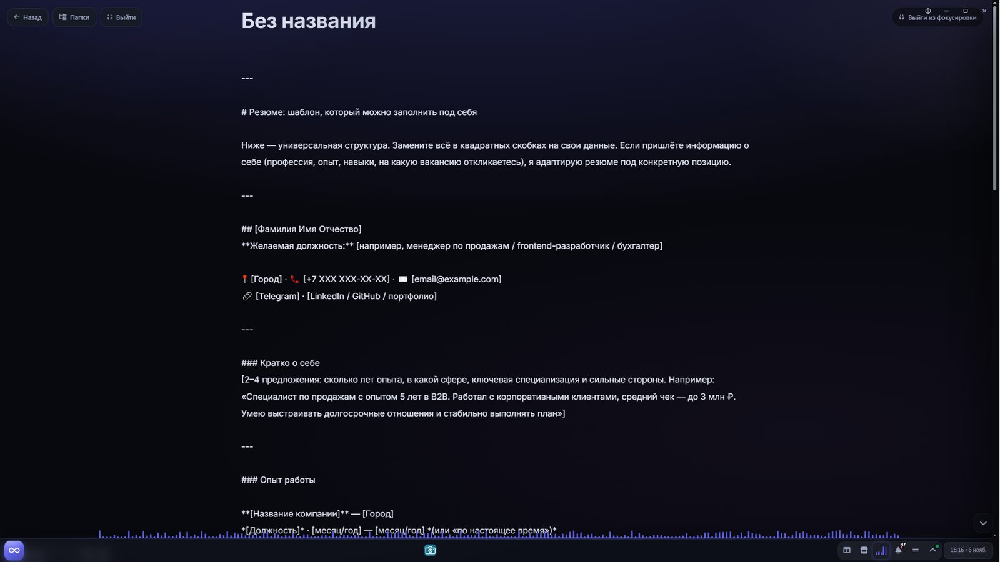 |
| Редактор с формулами и таблицами | Только текст, без лишнего |

| Офлайн-энциклопедии | Чтение ZIM |
|:--:|:--:|
| 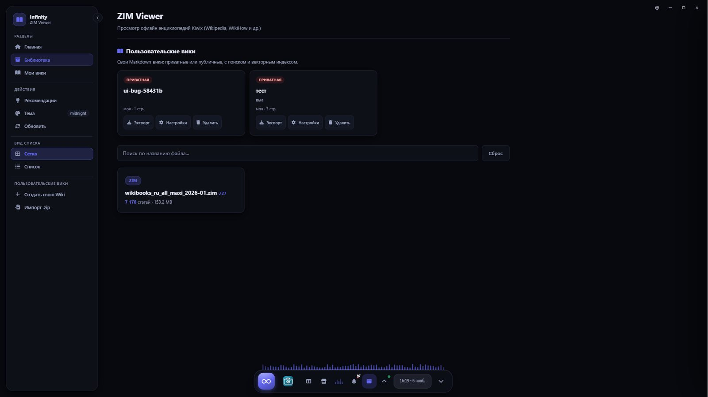 | 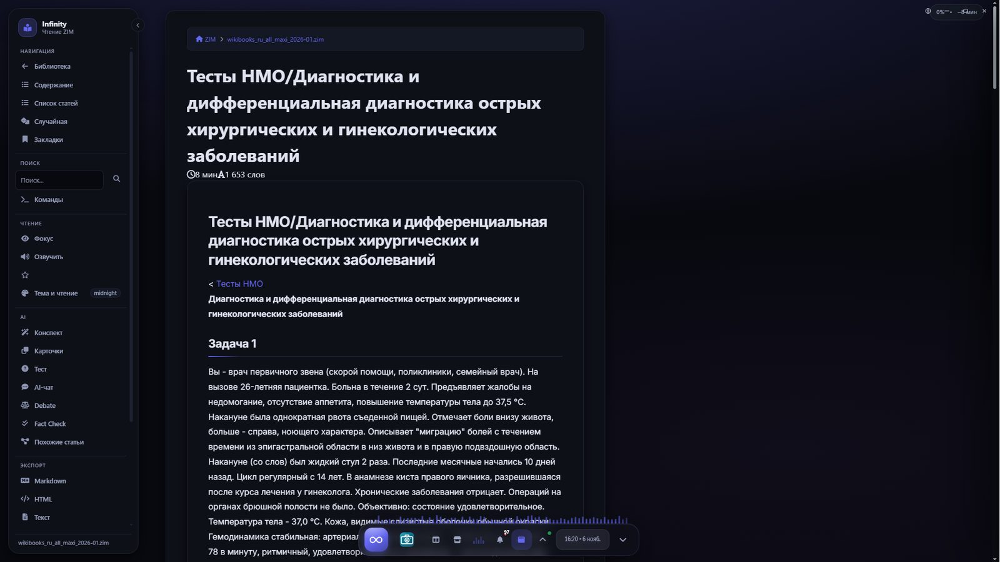 |
| Библиотека ZIM-архивов | Статьи с оглавлением и поиском |

| Обучение | Настройки |
|:--:|:--:|
| 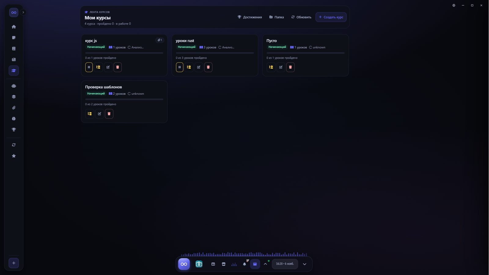 | 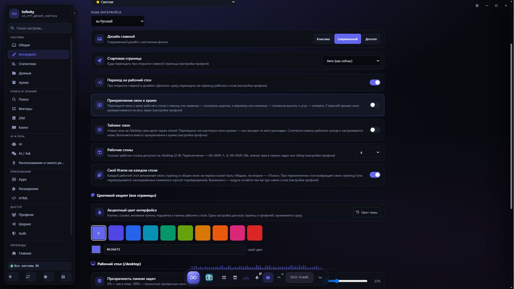 |
| Курсы, уроки и прогресс | Интерфейс, темы и рабочие столы |

| Встроенные приложения |  |
|:--:|:--:|
| 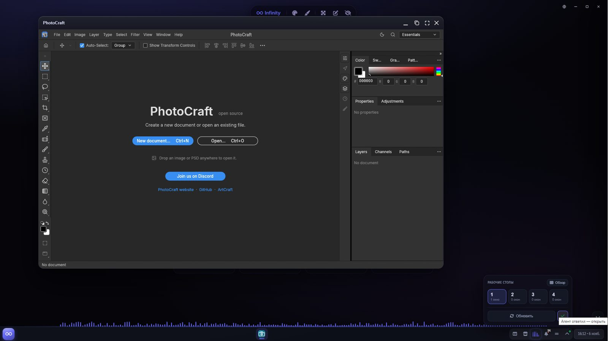 |  |
| Графика, документы, таблицы и 3D — в одном окне |  |

---

## Быстрый старт

### Вариант 1 — готовый портативный архив

Скачайте архив из раздела **Releases**, распакуйте в любую папку и запустите:

```bat
start.bat
```

Ничего устанавливать не нужно: Python, зависимости и движок уже внутри. При первом
запуске создаются папки `data`, `logs`, `models` и профиль по умолчанию.

### Вариант 2 — из исходников

Нужен **Python 3.12+** для Windows и, по желанию, Node.js для окна Electron.

```bat
git clone https://github.com/noevekshen545/infinitygihub.git
cd infinitygihub
setup.bat
```

`setup.bat` — интерактивный мастер: проверит Python, создаст окружение, поставит
зависимости и спросит, что ещё установить: Electron, ffmpeg, Chromium, Whisper,
Silero, Piper, Qdrant-эмбеддинги, Hermes, llama.cpp, gguf-модель, VLC, Calibre,
ComfyUI и каталог приложений. Можно выбрать только нужное.

Ручной вариант:

```bash
./scripts/bootstrap.sh --all
```

Или в PowerShell:

```powershell
.\scripts\bootstrap.ps1 -All
```

Затем:

```bat
run-dev.bat
```

Откройте <http://127.0.0.1:8281>.

`bootstrap` ставит Python- и Electron-зависимости, создаёт каталоги, скачивает Chromium
для встроенного браузера и ffmpeg. Тяжёлые движки и модели подключаются отдельно — см.
[`docs/EXTERNAL.md`](docs/EXTERNAL.md).

> Если нужен только веб-интерфейс без Electron, достаточно `run-dev.bat` — окно
> приложения не обязательно.

---

## Сколько занимает

| Вариант | Что внутри | Размер |
|---|---|---:|
| **Исходники без агента** | код, шаблоны, стили, скриншоты и документация | **~100 МБ** |
| **Репозиторий как есть** | плюс Hermes Agent, 3D-аватары и Avi | **~350 МБ** |
| **Репозиторий с историей** | то же плюс каталог `.git` | **~500 МБ** |
| **Портативная лёгкая** | exe, встроенный Python, Hermes, движок, Electron — без моделей | **~3.9 ГБ** |
| **Портативная полная** | плюс ffmpeg, VLC, Playwright, Calibre и профиль агента | **~7 ГБ** |
| **С моделями и каталогами** | плюс модели, ComfyUI и каталог приложений | **~25 ГБ** |
| **Рабочая машина** | плюс пользовательские данные, кэш и резервные копии | **~35 ГБ** |

Почему репозиторий весит около 370 МБ: примерно 100 МБ — исходники и фронтенд-
библиотеки для офлайн-работы (Monaco, Univer, Luckysheet, Plotly, Three.js, шрифты и
89 HTML-страниц), 162 МБ — Hermes Agent, 111 МБ — 3D-аватары. Зависимости Python и
`node_modules` не хранятся в Git: их скачивает `bootstrap`. Если агент и аватары не
нужны в репозитории, их можно вынести в отдельный release-ассет и вернуться к ~100 МБ.

---

## Документация

- [`docs/INSTALL.md`](docs/INSTALL.md) — установка, обновление и варианты поставки.
- [`docs/USER-GUIDE.md`](docs/USER-GUIDE.md) — первое знакомство и работа с разделами.
- [`docs/MODULES.md`](docs/MODULES.md) — описание всех модулей и их возможностей.
- [`docs/EXTERNAL.md`](docs/EXTERNAL.md) — движки, модели и внешние компоненты.
- [`docs/FAQ.md`](docs/FAQ.md) — частые вопросы и решения проблем.
- [`docs/DEVELOPMENT.md`](docs/DEVELOPMENT.md) — структура проекта и сборка.

---

## Технологии

Приложение собрано на Python и Electron. Интерфейс — обычные HTML, CSS и JavaScript,
которые работают в окне приложения и в браузере. Локальные модели подключаются через
совместимый интерфейс, поэтому можно выбрать готовый движок или внешний сервис.

Проект не требует облака, подписок и постоянного подключения к интернету. Всё, что
нужно для работы, лежит рядом с приложением.

---

## Лицензия

[MIT](LICENSE) © 2026 Infinity Search contributors.

Сторонние компоненты (Hermes Agent, Calibre, ComfyUI, ffmpeg, VLC и другие) распространяются
под своими лицензиями. Подробности — в [`docs/EXTERNAL.md`](docs/EXTERNAL.md).

---

<div align="center">

**Infinity Search** · [github.com/noevekshen545](https://github.com/noevekshen545)

<sub>Сделано для тех, кто хочет держать свои знания при себе.</sub>

</div>
